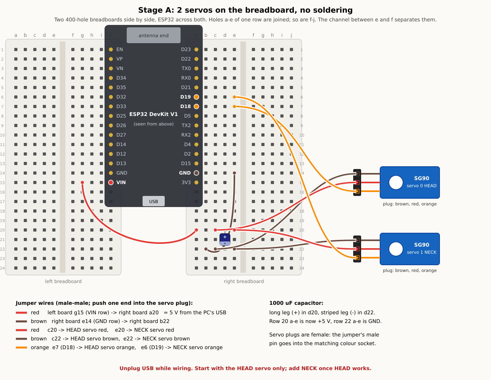

# Stage A: breadboard servo test (no soldering)

Goal: prove that the robot firmware moves real servos on the right GPIOs, before anything is soldered. One or two servos only, powered from the ESP32's `VIN` pin.



## Why only 1-2 servos here

In this stage everything, ESP32 and servos, runs from the PC's USB port through the DevKit's `VIN` pin. A USB 2.0 port gives about 500 mA, a USB 3 port about 900 mA. An SG90 draws little when idle, a few hundred mA while it moves, and more when it is blocked or starts against a load. The ESP32's Wi-Fi adds its own peaks. Two servos moving at once can pull the 5 V low enough to reset the ESP32 (a brownout). The 1000 uF capacitor covers the short spikes, not a long overload. All five servos wait for Stage B and the separate charger.

## What you need

- The ESP32 on the kit's two 400-hole breadboards, the way the kit lessons place it: left pin row in column `j` of the left board, right pin row in column `a` of the right board, `EN` / `D23` in row 1. If your ESP32 sits on other rows, keep the pin names and shift the row numbers with it.
- One 1000 uF 16 V electrolytic capacitor.
- One or two SG90 servos, with a horn pushed on so you can see the motion. Leave them loose on the desk, not in the robot.
- Male-male jumper wires from the kit: 3 red, 3 brown, 2 orange (any colour works; matching the servo colours avoids mistakes).

The RGB LED from the status-light lesson can stay: its ground jumper sits in `c14` and its other parts in the `f-j` half, and this stage uses different holes.

## S1. Wire it (USB unplugged)

Done when: every jumper in the table is in place and the capacitor's stripe faces row 22.

| # | Jumper | From | To | Net |
| --- | --- | --- | --- | --- |
| S1.1 | red | left board `g15` (the `VIN` row) | right board `a20` | +5 V |
| S1.2 | brown | right board `e14` (the `GND` row) | right board `b22` | GND |
| S1.3 | capacitor | long leg (+) in `d20` | striped leg (-) in `d22` | across +5 V / GND |
| S1.4 | HEAD servo | brown socket from `c22`, red socket from `c20` | orange socket from `e7` (`D18`) | servo 0 |

Rows 20 (`a-e`) and 22 (`a-e`) are now the little +5 V and GND rails. The servo plug is female: push the male end of a jumper into each socket of the plug, matching the colours.

Leave the NECK servo out for now.

## S2. Check before power

Done when: both checks pass.

1. Meter on continuity (beep). Probe `a20` and `b22`: it must **not** beep. A beep means +5 V and GND are shorted; find the wrong jumper.
2. Look at the capacitor: the stripe with the minus signs is on the row 22 side.

## S3. Power up and test servo 0 (HEAD)

Done when: the HEAD servo follows the slider on the `Servo control` page.

1. Plug the ESP32 into the PC with its usual micro-USB cable.
2. The servo may twitch once at power-up, then the firmware moves it to its calibrated middle. That is normal.
3. Open the robot's web panel, page `Servo control` (`http://tiny-engineer.local/servo`, or the IP the OLED shows). If the panel asks for an access token, paste the robot's token.
4. Pick servo `0` and move the angle slider. The servo turns.

The slider stays inside the servo's saved min/max range. If the servo moves only a little, the saved range is narrow; calibration happens later in the setup wizard, not here.

## S4. Add the NECK servo

Done when: servo `1` moves on the same page and the ESP32 does not reset.

1. Unplug USB.
2. Plug the NECK servo: brown socket from `e22`, red socket from `e20`, orange socket from `e6` (`D19`).
3. Plug USB back in and test servo `1`.

If the ESP32 restarts when both servos move (the OLED goes back to the boot screen, the serial log shows `Brownout detector was triggered`), stay with one servo and move on to Stage B.

## Firmware: probably nothing to flash

The board should already run the robot firmware from the `esp32dev-ota` environment (the one with Wi-Fi updates): if the web panel opens and the OLED shows the face, it does. Its pin map is the one in [README.md](README.md), so no reflash is needed for this test.

If you do need to reflash over USB, use the same environment, from the repo root:

```sh
pio run -e esp32dev-ota -t upload
```

Notes:

- Plain `esp32dev` would also drive these pins, but it uses a different partition table (no OTA slots). Stay on the environment the board already has.
- The kit's servo lesson sketch would also drive `D18`, but flashing it replaces the robot firmware. Not needed.
- Serial log, if you want it: `pio device monitor -e esp32dev-ota` (115200 baud, port `/dev/ttyUSB0`).

Next: [Stage B, the perfboard](stage-b-perfboard.md).
