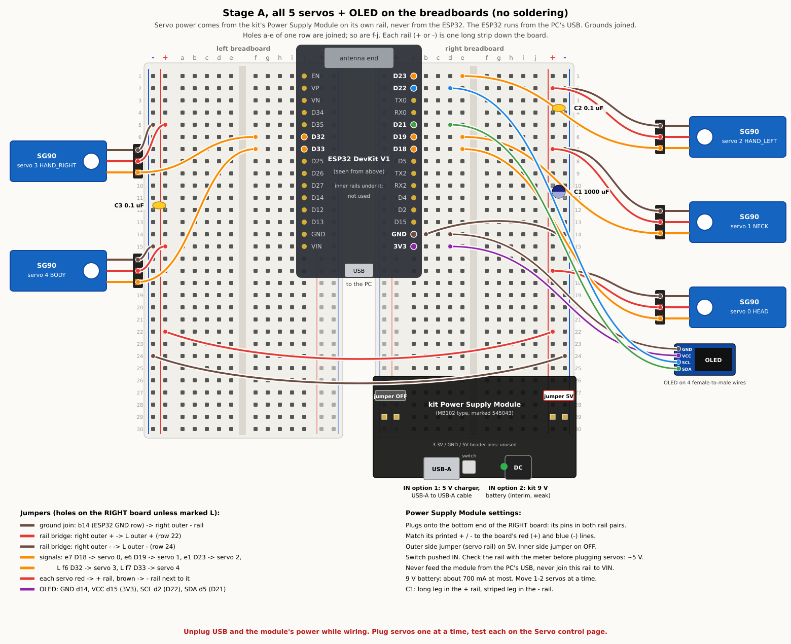

# Stage A, all 5 servos + OLED on the breadboards

The whole robot on the two breadboards, no soldering: five SG90 servos, the OLED and the ESP32. The two-servo test in [stage-a-breadboard.md](stage-a-breadboard.md) runs the servos from the ESP32's `VIN` pin. Five servos must not: the PC's USB port cannot carry them. Here the servos get their own rail from the kit's **Power Supply Module**, and the ESP32 stays on the PC's USB. The two supplies share ground and nothing else.

## Power: the crux

The ELEGOO ESP32 Super Starter Kit includes a "Power Supply Module" (the kit's packing list and its breadboard notes). It is the common MB102 design, marked `545043`. It plugs onto the end of a breadboard, with pins in both rail pairs. It has a 5V / OFF / 3.3V jumper for each side, an on/off switch, a barrel jack and a USB-A socket.

How much it can deliver depends on what feeds it:

| Feed | What happens | Good for |
| --- | --- | --- |
| **5 V charger into the USB-A socket** (needs a USB-A to USB-A cable, not in the kit) | 5 V goes to the 5V rail past the regulator, through the module's switch | all five servos; the best no-solder option |
| **Kit 9 V battery into the barrel jack** | an AMS1117 regulator makes 5 V, rated about 700 mA on this module; a 9 V battery also sags under load | 1-2 servos moving at a time; works today with kit parts only |
| **USB-C breakout with header pins**, plugged into the rails instead of the module | the 5 V 3 A charger straight onto the rail | all five servos; needs soldering (the iron arrives ~25-28 Nov) |

So:

1. **Today, kit parts only:** the module on the 9 V battery. With all five plugged in, the boot centring moves all five at once and the rail may sag: servos jitter or stall briefly. Nothing gets damaged: the regulator limits itself, and the ESP32 runs from its own USB, so it does not reset. Test servos one or two at a time.
2. **With a USB-A to USB-A cable** and a charger that has a USB-A port: the module's USB socket, switch pushed in. Full five-servo motion.
3. **After soldering:** the USB-C breakout with two header pins (VBUS, GND) replaces the module on the right board's outer rails. Same wiring otherwise.

Never feed the module from the PC's USB: that is the same weak supply as `VIN`. Never join this rail to the ESP32's `VIN` or `5V` pin.

## The breadboards and their rails

The diagram shows the boards as they lie on the desk: column letters `a`-`j` across the top, row numbers 1-30 down the side. Each board has a rail pair down each long edge, and in every pair the **red `+` strip is on the left and the blue `-` strip on the right**.

- Right board, outer pair (right edge): the servo rail, fed by the module.
- Right board, inner pair (left edge, under the ESP32): also 5 V from the module, because both module jumpers are on 5V. Nothing plugs into it; it runs under the ESP32, so keep stray jumpers out of it.
- Left board, outer pair (left edge): joined to the right outer pair by two bridge jumpers, for servos 3 and 4.
- Left board, inner pair (right edge, under the ESP32): unused.

## Parts

- ESP32 across the two breadboards: left pin row in column `j` of the left board, right pin row in column `a` of the right board, antenna end up, **`EN` / `D23` in row 16, `VIN` / `3V3` in row 30**. Its micro-USB socket then hangs past the bottom end of the boards and the cable plugs in freely. (This is 15 rows lower than in the kit lessons and the 2-servo test.)
- Power Supply Module, plugged onto the **top end of the right board** (rows 1-5), the end away from the ESP32's USB. Its USB-A and DC sockets face outward, off the board. It has 4 legs per side: 2 in the red `+` strip and 2 in the blue `-` strip, in rows 4 and 5.
- 1 x 1000 uF 16 V electrolytic (C1), 2 x 0.1 uF ceramic `104` (C2, C3).
- 5 x SG90.
- The OLED on 4 female-to-male wires (the kit has 10).
- Male-male jumpers: 3 per servo, plus 3 for the ground join and the rail bridges.

## S1. Power module and rails (everything unplugged)

Done when: the right outer rail reads about 5 V on the meter and the left outer rail matches it.

1. Set **both** module jumpers on `5V` (the jumper on the 5V-VCC pair of each side). Both rail pairs of the right board then carry 5 V.
2. Plug the module onto the top end of the right board, sockets facing away from the board. On each side its `+` legs go in the red strip and its `-` legs in the blue strip, rows 4-5. If its printed `+` / `-` does not line up with red / blue, stop: turning it round would swap 5 V and ground.
3. Bridges: red jumper from the right outer `+` (row 8) to the left outer `+` (row 8). Brown jumper from the right outer `-` (row 10) to the left outer `-` (row 10). Both pass above the ESP32's antenna end.
4. C1 across the right outer rails: **long leg in `+` row 12, striped leg in `-` row 13**. C2 across the right outer rails at row 7. C3 across the left outer rails at row 20.
5. Feed the module (battery or USB, see above), push the switch in. Meter on DC volts: about 5 V on the right outer rails, and the same on the left outer rails. A minus reading means `+` and `-` are swapped. Switch off.

## S2. ESP32 side (USB still unplugged)

Done when: the ground join and the OLED are in.

| Jumper | From | To |
| --- | --- | --- |
| ground join, brown | right board `b29` (ESP32 `GND` row) | right outer `-` rail, row 28 |
| OLED GND, brown | OLED `GND` | right board `d29` |
| OLED VCC, purple | OLED `VCC` | right board `d30` (`3V3`) |
| OLED SCL, blue | OLED `SCL` | right board `d17` (`D22`) |
| OLED SDA, green | OLED `SDA` | right board `d20` (`D21`) |

The OLED stays on the ESP32's `3V3` pin, never on the module's rails. The jumpers in `b29`, `d29` and `d30` sit beside the ESP32, clear of the USB plug.

## S3. Servos, one at a time

Done when: all five move on the `Servo control` page.

| Servo | Joint | Orange (signal) from | Red to | Brown to |
| --- | --- | --- | --- | --- |
| 0 | HEAD | right board `e22` (`D18`) | right outer `+` row 25 | right outer `-` row 25 |
| 1 | NECK | right board `e21` (`D19`) | right outer `+` row 20 | right outer `-` row 20 |
| 2 | HAND_LEFT | right board `e16` (`D23`) | right outer `+` row 15 | right outer `-` row 15 |
| 3 | HAND_RIGHT | left board `f21` (`D32`) | left outer `+` row 17 | left outer `-` row 17 |
| 4 | BODY | left board `f22` (`D33`) | left outer `+` row 25 | left outer `-` row 25 |

Any free hole of the same outer rail strip works for red and brown; the diagram uses the rows in the table, next to each servo. The servo plug is female: push one male end of each jumper into its socket, matching the colours.

For each servo:

1. Module switch off, ESP32 USB unplugged.
2. Wire the servo's three jumpers.
3. Plug in the ESP32's USB, switch the module on.
4. Test it on the web panel's `Servo control` page (`/servo`), servo index as in the table.

The firmware on the board already drives all five pins (`esp32dev-ota` build, see [stage-a-breadboard.md](stage-a-breadboard.md#firmware-probably-nothing-to-flash)): nothing to flash.

## Before every power-up

- Both module jumpers are on `5V`.
- C1's stripe is on the `-` rail.
- Meter on beep, nothing powered: right outer `+` to `-` does **not** beep.
- Only one 5 V source per rail: the module (or later the breadboard USB-C) feeds the servo rail; the PC's USB feeds only the ESP32.

Full list: [checklist.md](checklist.md).
