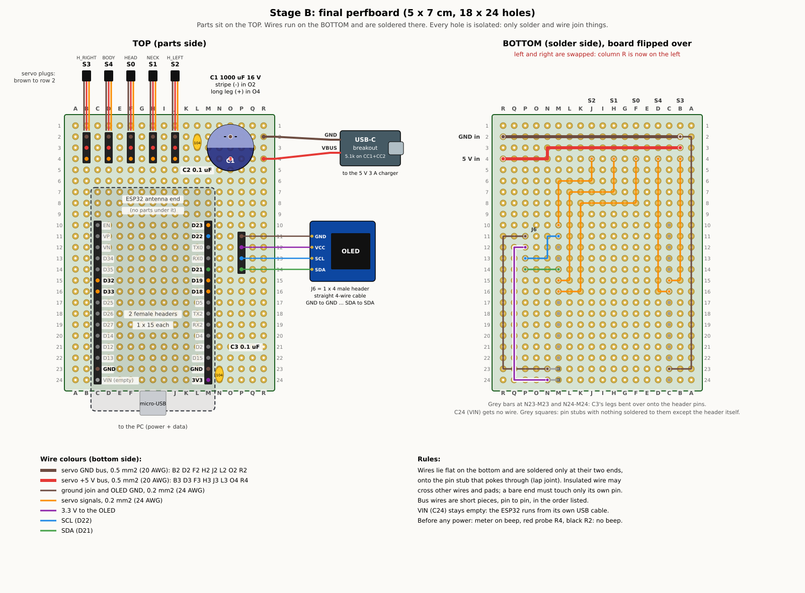

# Stage B: final perfboard

All five servos on their own 5 V rail from a USB-C breakout and a 5 V 3 A charger, the OLED on the ESP32's 3.3 V, the ESP32 itself on the PC's USB. One ground join. The ESP32 plugs into female headers, so it comes off the board without desoldering.

Circuit: [schematic.svg](schematic.svg). Safety list: [checklist.md](checklist.md).

## The board and how to read the hole names

- Board: one double-sided 5 x 7 cm perfboard. Count its holes first: the layout needs **18 columns x 24 rows**. A smaller board does not fit this layout.
- Every hole is plated and joined only to its own pad on the other side. Nothing is connected until solder or a wire connects it.
- Hold the board with the long side vertical. Columns are letters `A` to `R` from left to right, rows are `1` to `24` from top to bottom, **as seen from the top (parts side)**. Write `A1` with a marker next to the top-left hole, and `TOP` on that side.
- Parts go in from the top. Solder and wires are on the bottom. When you flip the board over, left and right swap: column `R` is then on your left. The bottom view in the diagram is drawn already flipped.

## Parts

| Ref | Part | Holes |
| --- | --- | --- |
| ESP32 headers | 2 x female header, 1 x 15 (cut from the 1 x 40 strips) | `C10`-`C24` and `M10`-`M24` |
| S0-S4 | 5 x male header, 1 x 3 | see the servo table |
| J6 | 1 x male header, 1 x 4 (OLED) | `P11`-`P14` |
| C1 | 1000 uF 16 V electrolytic | stripe (-) in `O2`, long leg (+) in `O4` |
| C2 | 0.1 uF ceramic (`104`) | `L2`, `L3` |
| C3 | 0.1 uF ceramic (`104`) | `N23`, `N24` |
| Power in | USB-C breakout, 2 wires of 0.5 mm2 (20 AWG) | GND to `R2`, VBUS to `R4` |

A female 1 x 40 strip loses one pin where you cut it: cut through the 16th pin to get 15.

### Servo headers

Each header stands in rows 2-4: **row 2 = brown (GND), row 3 = red (+5 V), row 4 = orange (signal)**. Plug every servo with its brown wire towards the board edge (row 2).

| Header | Column | Servo | Signal from ESP32 pin |
| --- | --- | --- | --- |
| S3 | `B` | 3 HAND_RIGHT | `D32`, hole `C15` |
| S4 | `D` | 4 BODY | `D33`, hole `C16` |
| S0 | `F` | 0 HEAD | `D18`, hole `M16` |
| S1 | `H` | 1 NECK | `D19`, hole `M15` |
| S2 | `J` | 2 HAND_LEFT | `D23`, hole `M10` |

The order looks odd on purpose: it keeps the signal wires from crossing. Label each header on the board with its servo name.

### ESP32 header holes

| Row | `C` (left row) | `M` (right row) |
| --- | --- | --- |
| 10 | EN | D23 (S2 signal) |
| 11 | VP | D22 (OLED SCL) |
| 12 | VN | TX0 |
| 13 | D34 | RX0 |
| 14 | D35 | D21 (OLED SDA) |
| 15 | D32 (S3 signal) | D19 (S1 signal) |
| 16 | D33 (S4 signal) | D18 (S0 signal) |
| 17 | D25 | D5 |
| 18 | D26 | TX2 |
| 19 | D27 | RX2 |
| 20 | D14 | D4 |
| 21 | D12 | D2 |
| 22 | D13 | D15 |
| 23 | GND (ground join) | GND (OLED GND, via C3) |
| 24 | VIN (**no wire**) | 3V3 (OLED VCC, via C3) |

The antenna end of the ESP32 (row 10 side) points at the servo headers; the micro-USB socket hangs over the bottom edge, past row 24, so the cable plugs in.

## Wires (all on the bottom)

How to make each joint: strip 3 mm, twist and tin the end, lay it against the pin stub that pokes through the board, touch with the iron until the solder flows around both. Do not trim the header pins: the wires solder onto them. Insulated wire may cross other wires and pads; only the bare end may touch metal, and only its own pin.

| # | Wire | Gauge | Route (holes) |
| --- | --- | --- | --- |
| W1 | servo GND bus, brown/black | 0.5 mm2 (20 AWG) | short pieces pin to pin: `B2` `D2` `F2` `H2` `J2` `L2` `O2` `R2` |
| W2 | servo +5 V bus, red | 0.5 mm2 (20 AWG) | `B3` `D3` `F3` `H3` `J3` `L3`, then `L3` to `O4` (C1 +), then `O4` to `R4` |
| W3 | ground join, brown | 0.2 mm2 (24 AWG) | `C23` (ESP32 GND) along column A to `B2` |
| W4 | S3 signal, orange | 0.2 mm2 (24 AWG) | `C15` to `B4` |
| W5 | S4 signal, orange | 0.2 mm2 (24 AWG) | `C16` to `D4` |
| W6 | S0 signal, orange | 0.2 mm2 (24 AWG) | `M16` to `F4` |
| W7 | S1 signal, orange | 0.2 mm2 (24 AWG) | `M15` to `H4` |
| W8 | S2 signal, orange | 0.2 mm2 (24 AWG) | `M10` to `J4` |
| W9 | OLED SDA, green | 0.2 mm2 (24 AWG) | `M14` to `P14` |
| W10 | OLED SCL, blue | 0.2 mm2 (24 AWG) | `M11` to `P13` |
| W11 | OLED GND, brown | 0.2 mm2 (24 AWG) | C3 leg at `N23` to `P11` |
| W12 | OLED 3.3 V, purple | 0.2 mm2 (24 AWG) | C3 leg at `N24` to `P12` |

The routes in the bottom view are suggestions that avoid crossings; the wire only has to join its two end holes. Wire colours are for your own sanity: use what you have, but keep red for +5 V and brown or black for ground.

C3: push its legs through `N23` and `N24`, then on the bottom bend each leg sideways onto the pin stub next to it (`M23` GND, `M24` 3V3) and solder it there. The legs are the connection. W11 and W12 start from those same legs.

## Build order

### S1. Prepare (no iron yet)

Done when: all parts sit loosely in the right holes and match the top view.

1. Count the board: 18 x 24 holes. Mark `A1` and `TOP`.
2. Cut the headers: two 1 x 15 female, five 1 x 3 male, one 1 x 4 male.
3. Dry fit the ESP32: push both female strips onto the ESP32's pins, then set the whole thing on the board with the left strip in `C10`-`C24` and the right strip in `M10`-`M24`. All 30 header pins must drop into holes without bending. If the right strip only fits one column further over, the board's row spacing differs from this layout: stop and re-plan before soldering.
4. Check the USB-C breakout's pads with the meter before soldering any wire to it: charger plugged in, meter on DC volts, red probe on the pad you think is VBUS, black on GND. You want about +5 V. A minus sign means the probes are on swapped pads. Pad names vary (`VBUS`, `V`, `VCC`, `5V`, `+`; `GND`, `G`, `-`). Leave the CC pads alone: the 5.1k resistors are already on the breakout.

### S2. Solder the parts, lowest first

Done when: every part is soldered, each joint is a shiny cone, and no solder bridges join neighbouring pads.

1. C2 and C3 (ceramics). C3's legs bent onto `M23` / `M24` as described above.
2. The five servo headers and J6. Solder one pin, check the header stands straight, then the rest.
3. The two ESP32 female strips, with the ESP32 plugged into them so they stay aligned. Solder the four corner pins first, take the ESP32 out, then solder the rest.
4. C1 last (it is the tallest): stripe to `O2`, long leg to `O4`. Check twice before soldering.
5. The two power leads from the USB-C breakout: 0.5 mm2 (20 AWG), GND into `R2`, VBUS into `R4`, from the top, soldered on the bottom. A drop of hot glue or a cable tie through spare holes keeps them from pulling on the joints.

### S3. Wire the bottom

Done when: W1-W12 are all in, ticked off one by one against the table.

Do the buses first (W1, W2), then W3, then the signals, then the OLED wires.

### S4. Meter checks, ESP32 out, nothing powered

Done when: every line below passes. Meter on continuity (beep).

| Probe | Probe | Expect |
| --- | --- | --- |
| `R4` (+5 V) | `R2` (GND) | **no beep** |
| `R2` | `M23` (ESP32 GND) | beep (ground join) |
| `R4` | `C24` (VIN) | **no beep** |
| `P12` (3V3) | `P11` (GND) | **no beep** |
| row 2 of each servo header | `R2` | beep |
| row 3 of each servo header | `R4` | beep |
| row 4 of S0 / S1 / S2 / S3 / S4 | `M16` / `M15` / `M10` / `C15` / `C16` | beep |
| row 3 of each servo header | row 4 of the same header | **no beep** |

A short beep when probing across C1 can be the capacitor charging from the meter; a steady beep is a short.

### S5. First power, then servos one by one

Done when: all five servos move on the `Servo control` page and the ESP32 does not reset when they centre at boot.

1. No ESP32, no servos. Plug the charger into the USB-C breakout. Meter on DC volts: red on `R4`, black on `R2`. Expect about 5 V, positive. Unplug the charger.
2. Plug the ESP32 into its headers, antenna end towards the servo headers, `EN` in `C10`. Plug the OLED cable into J6: GND to GND, VCC to VCC, SCL to SCL, SDA to SDA (a straight 4-wire cable when the OLED's pins read `GND VCC SCL SDA`).
3. Connect the ESP32's micro-USB to the PC. The OLED shows the boot screen and then the face.
4. Plug servo 0 (HEAD) into S0, brown to row 2. Plug the charger in. Test servo `0` on the `Servo control` page.
5. Unplug the charger, add the next servo, plug the charger back in, test it. Repeat for 1, 2, 3, 4.

With all five in, power-cycle once and watch the boot: all five centre together. That is the heaviest moment for the charger.
